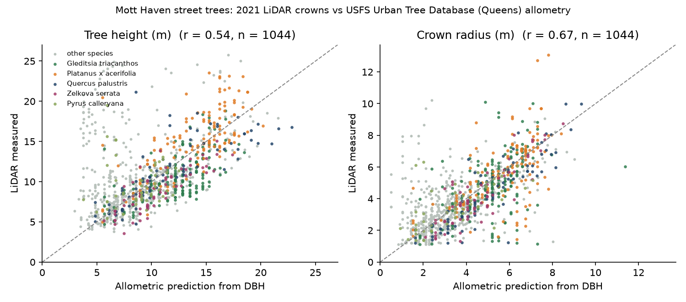

# Shade Queue 🌳

**Where does NYC's street-tree shade actually fall, and where should Parks plant next?**

Shade Queue is an open, extensible rebuild of the core of
[TreeFolio NYC](https://www.treefolio.org/), made entirely from public data. It gives each
street tree a 3D crown model, measured from LiDAR or estimated from trunk diameter, and simulates
the shade that crown casts, hour by hour, against the real buildings around it.



| Stage | Status |
|---|---|
| **v0** Per-tree crowns + shade simulation + web map, Mott Haven pilot | ✅ working |
| **v1** Rank empty tree pits by shade deficit × heat vulnerability | pits mapped with HVI; scoring designed (`pipeline/sites/score.py`) |
| **v2** Recommend species, simulate their shade at 5/10/15 years | `POST /simulate` and the map's "plant here" panel already work end to end |

## Quick start

Needs [uv](https://docs.astral.sh/uv/). Python 3.12 and all dependencies install automatically.

```bash
make setup                 # create .venv
make data                  # fetch NYC Open Data for the pilot area and simulate (~1 min, allometric crowns)
make lidar                 # optional: 2.5 GB LiDAR download, then measured crowns (~5 min)
make serve                 # http://127.0.0.1:8811  (API docs at /docs)
make test
```

Every command takes `AOI=<name>` from [`aois.yaml`](aois.yaml), so adding a neighbourhood
means adding a bounding box there.

## What you see

- **3D crowns** coloured by where they came from: green = LiDAR, olive = allometric (from DBH),
  orange = predicted (a hypothetical planting).
- **Shadows** for any hour on the solstices and equinoxes. Press ▶ to animate the day.
- **Click a tree** to see its height, crown, data confidence, and hourly sidewalk shade, net of
  shade the buildings already provide.
- **Click an orange empty pit** to pick a species and see its predicted crown and shadow at
  5, 10 and 15 years, from the *same* simulator.
- **Heat vulnerability** overlay (DOHMH HVI by neighbourhood). The whole pilot area is HVI 5/5.

## How it works

```
NYC Open Data ─┐
NYS LiDAR ─────┼─ ingest/ ─► canopy/ ─► CrownModel ─► shade/ ─► ShadeResult ─► GeoParquet ─► api/ ─► web/
USFS UTD ──────┘                ▲                                   │
                       growth/ (species × years → predicted crown) ─┘
```

- **Crowns from LiDAR**: we build a canopy-height model from the 2021 NYC LiDAR, then segment it
  into individual crowns with a watershed *seeded by the Parks tree inventory points*, so every
  crown links to a Parks tree ID ([ADR-0003](docs/adr/0003-inventory-seeded-segmentation.md)).
- **Crowns from allometry**: USFS Urban Tree Database equations (McPherson et al. 2016) whose
  Northeast coefficients were measured on Queens street trees. These fill in trees LiDAR misses
  (171 were planted after the 2021 flight) and drive the growth predictions.
- **Shade**: pvlib computes the sun position. Each crown's shadow is the convex hull of its
  projected horizontal slices, and each building's shadow is its footprint swept along the sun
  vector. 1,549 trees × 44 sun positions take about 40 s
  ([ADR-0002](docs/adr/0002-projected-shadows.md)).
- **Contracts first**: the simulator only accepts `CrownModel`, so measured, estimated and
  predicted trees are interchangeable ([ADR-0001](docs/adr/0001-contracts.md)).

Read [ARCHITECTURE.md](ARCHITECTURE.md) for module boundaries and [plan.md](plan.md) for today's checklist.

## Repo map

| Path | What |
|---|---|
| `pipeline/contracts.py` | Data contracts (start here) |
| `pipeline/ingest/` | Socrata, LiDAR, buildings, streets/sidewalks, HVI |
| `pipeline/canopy/` | `extract.py` (LiDAR crowns), `fallback.py` (allometric crowns) |
| `pipeline/growth/` | UTD allometry + `predict_crown()` for plantings |
| `pipeline/shade/` | sun, shadow geometry, simulator, daily metrics |
| `pipeline/sites/` | empty-pit discovery (`score.py` = v1) |
| `api/main.py` | FastAPI + DuckDB spatial over `data/processed/` |
| `web/` | static deck.gl + MapLibre page, no build step |
| `docs/adr/` | decision records |

## Data sources (all public; verified live 2026-11-14)

| Data | Source |
|---|---|
| Street trees (live) | NYC Parks ForMS *Forestry Tree Points* `hn5i-inap` |
| Empty planting sites | ForMS *Forestry Planting Spaces* `82zj-84is` (`psstatus = Empty`) |
| 2015 Street Tree Census | `uvpi-gqnh` (ingested for reference) |
| Building footprints + roof heights | `5zhs-2jue` (formerly `qb5r-6dgf`) |
| Street centerlines + widths | `inkn-q76z` |
| Neighbourhoods (NTA 2020) | `9nt8-h7nd` |
| Heat Vulnerability Index | NYC DOHMH EH Data Portal, indicator 2411 (by NTA) |
| LiDAR | NYS GIS Clearinghouse, NYC 2021 (12 pts/m², flown May 2021) |
| Allometry | USFS Urban Tree Database, RDS-2016-0005 (Northeast / Queens) |

Raw and processed data live in `data/` (gitignored). The pipeline re-downloads everything.

## Limitations (v0)

Crowns are opaque solids and trees don't shade each other. The sidewalk is approximated as a
4.5 m band beyond the curb. Façade shade is approximate. Terrain is treated as flat. In LiDAR,
a sapling next to a large tree can be mislinked to its neighbour's crown; `confidence` flags
these. Details are in the ADRs.

## Ethics

Public city data only. The unit of analysis is a tree or a planting pit, never a person. We
don't ingest census volunteer or steward fields, and we use heat vulnerability only at
neighbourhood level.

## Credits

Inspired by TreeFolio NYC (Cornell Design Across Scales Lab). This is an independent rebuild
from public inputs and is not affiliated with TreeFolio.
